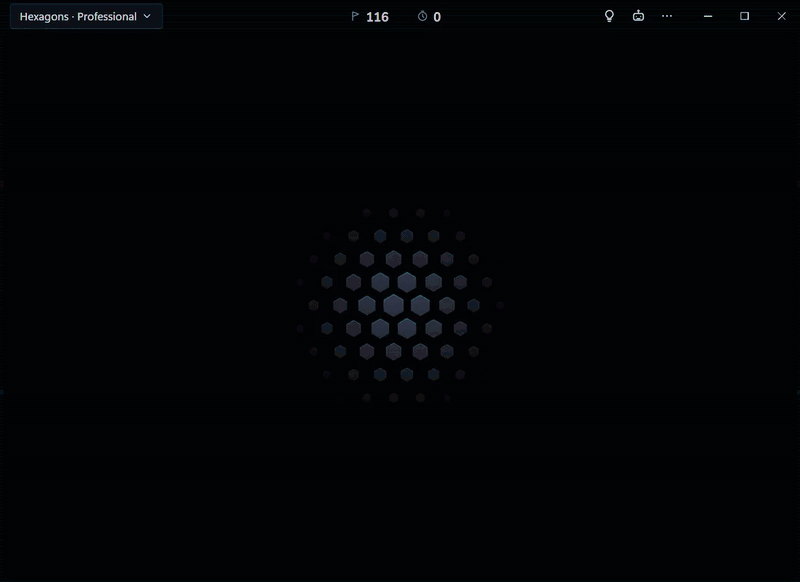

# Polymine

Minesweeper on many tilings, with an assistant that can hint or play the whole
game. Polymine is a desktop game for Windows and macOS, built with Rust, Tauri,
and Svelte.



## Download

Get the latest version from the
[releases page](https://github.com/uvw/polymine/releases/latest):

1. **Windows:** the installer, `Polymine_<version>_x64-setup.exe`.
2. **Windows, portable:** `Polymine_<version>_x64_portable.zip`. Unzip it
   anywhere and run `Polymine.exe`.
3. **macOS, Apple silicon:** `Polymine_<version>_aarch64.dmg`.
4. **macOS, Intel:** `Polymine_<version>_x64.dmg`.
5. **macOS, with Homebrew:** `brew install --cask uvw/tap/polymine`.

The builds aren't signed yet, so Windows SmartScreen and macOS Gatekeeper warn
on first launch. Each release page says how to open the app anyway.

## Features

- Tilings from squares and hexagons to herringbone bricks, kites, pentagon
  florets, and snub squares. Cells count as neighbors when they share an edge or
  a corner, so a triangle has 12 neighbors and a Cairo pentagon has seven.
- Beginner, Amateur, Professional, and Crazy levels, plus custom boards. The
  level sets the mine density. Each tiling's shape adds a measured complexity,
  from 1 to 5, shown in the tiling picker.
- A first click that is never a mine, and opens an area whenever the board has
  room.
- Flags, optional question marks, and smart click. Clicking a number flags its
  neighbors when they must all be mines, then opens the rest once the flags
  match.
- An assistant that shows the next safe move or plays the game itself. It plays
  the moves the numbers force, and when none is left it opens the cell least
  likely to hold a mine. A move it calls certain is always right.
- Statistics and a champions table per tiling and level. Assisted and custom
  games don't count toward records.
- A native look on Windows 11 and macOS that follows the system's light or dark
  mode, built-in themes, and themes players make as folders of CSS variables.
- A color filter for deuteranopia, protanopia, or tritanopia. Themes that show
  counts by color alone draw high counts as rings and list every count in a key
  under the board.
- Keyboard play with screen reader announcements, zoom, and reduced-motion
  support.
- A command line, `polymine-cli`, that plays from a terminal or a coding agent
  and shares a history across machines through a GitHub gist.

## Keys

| Key          | Action                                             |
| ------------ | -------------------------------------------------- |
| Arrows, WASD | Move on the board                                  |
| Enter, Space | Open the focused cell                              |
| F            | Flag the focused cell                              |
| N, F2        | New game (also Ctrl+N on Windows, Cmd+N on macOS)  |
| 1 to 4       | Beginner, Amateur, Professional, Crazy             |
| 5            | Custom level                                       |
| H            | Hint                                               |
| B            | Bot on or off                                      |
| P, Pause     | Pause or resume                                    |
| Esc          | Pause and minimize                                 |
| F1           | About                                              |
| F3, F4       | Statistics and champions                           |
| F5           | Settings (Ctrl+, on Windows, Cmd+, on macOS)       |
| Ctrl+S       | Saves (Cmd+S on macOS)                             |
| + or =, -    | Zoom in, zoom out                                  |
| \*, /        | Zoom to the largest cells, back to the fitted size |

A dialog's key closes it when pressed again inside it. The wheel or a trackpad
pinch over the board resizes the window.

## Your data

Settings, finished games (`history.jsonl`), the saved game, named saves (in
`saves`), player themes (in `themes`), and the window's place live in a
`Polymine` folder: `%APPDATA%\Polymine` on Windows and
`~/Library/Application Support/Polymine` on macOS. A portable copy, such as the
Windows ZIP, keeps everything in a `data` folder beside the executable instead.

## Themes

Pick a theme on the Themes page in Settings. Polymine comes with
[built-in themes](docs/design.md#built-in-themes), from frosted glass to code
editor color schemes, and reads the themes you make. A theme is a folder with a
`theme.css` of CSS variables in the `themes` folder.
[Creating a theme](docs/themes/creating-a-theme.md) walks you through one and
lists every variable.

## Command line

`polymine-cli` plays Polymine from a terminal or a coding agent and prints JSON.
It drives a running window, where every move animates, or plays headless games
with `--local`.

The installers bundle it with the app:

1. On Windows, it sits next to `Polymine.exe` in the install folder. The
   installer puts it on your `PATH`, so open a new terminal afterwards.
2. On macOS, it sits inside the app, at
   `/Applications/Polymine.app/Contents/MacOS/polymine-cli`. Run
   `polymine-cli link` once by that full path to link it into `~/.local/bin`.
   The Homebrew cask puts it on your `PATH` for you.

```sh
polymine-cli status
polymine-cli --local practice new --tiling kite --seed 7
polymine-cli skill    # the guide for coding agents
```

[docs/CLI.md](docs/CLI.md) covers the commands, instances, sharing a history
through a gist, the output contract, and exit codes.

## Contributing

Bug reports and pull requests are welcome. [CONTRIBUTING.md](CONTRIBUTING.md)
covers building from source, the checks, and the rules for changes, and the
[docs index](docs/README.md) lists every document by reader. Report a security
problem privately, as [SECURITY.md](SECURITY.md) describes.

## Credits

Inspired by FastMines by Sergey Krivulya. Polymine is a new implementation and
shares no code with it.

## License

Licensed under either of [Apache License 2.0](LICENSE-APACHE) or
[MIT license](LICENSE-MIT) at your option.
